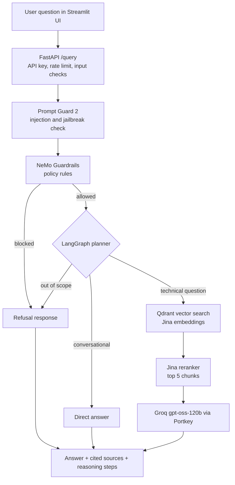
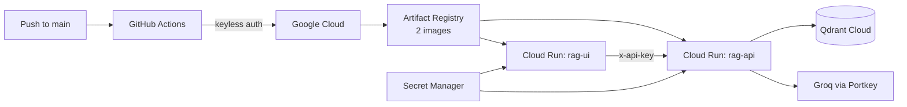
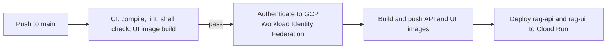

# Enterprise Agentic RAG System

An agentic RAG assistant that answers questions about enterprise IT documentation (Kubernetes, Intel hardware, enterprise networking) with cited sources, layered guardrails and measured quality.

**[Live demo](https://rag-ui-4goiiukcaa-el.a.run.app)** &nbsp;|&nbsp; Built with LangGraph, Qdrant, Jina, Groq (via Portkey), FastAPI, Streamlit, Docker and GCP Cloud Run

> **Note:** the demo runs on Cloud Run with scale-to-zero, so the **first load can take about a minute** while the container starts. After that, answers come back in a few seconds.

---

## Problem Statement

Engineers lose time searching long, scattered technical documents. A plain chatbot is fast but unreliable: it invents answers, cannot cite where they came from, and can be pushed off-topic or manipulated with prompt injection. A simple "retrieve and answer" pipeline also wastes tokens by searching the documents for messages like "hello".

## Proposed Solution

This project is a production-style RAG system with these ideas:

- **Agentic routing.** A LangGraph planner decides, per message, whether to search the documents, answer directly (greetings, small talk, conversation memory), or refuse.
- **Grounded answers.** Retrieved chunks are reranked and passed to the LLM. Answers cite the source files, and the UI shows the exact chunks used.
- **Layered safety.** Prompt Guard 2, NeMo Guardrails and a planner scope check filter injection attempts and off-topic requests before any retrieval happens.
- **Measured quality.** The system is evaluated with RAGAS on a golden dataset, and the results are reported below, including their limits.
- **Production basics.** API-key authentication, rate limiting, input validation, secrets in Secret Manager, Docker images, and a CI/CD pipeline that deploys on every push to `main`.

---

## Architecture

### Query flow



### What each stage does

| Stage | Purpose |
|---|---|
| Input checks | Require an API key, limit requests per client, cap question length, validate the session id |
| Prompt Guard 2 | Small classifier that flags prompt injection and jailbreak attempts |
| NeMo Guardrails | Policy rules for unsafe or disallowed requests |
| Planner (LangGraph) | Chooses retrieval, direct answer, or refusal; rewrites the question into a search term |
| Retrieval | Embeds the search term with Jina and queries Qdrant Cloud |
| Rerank | Jina reranker keeps the 5 most relevant chunks |
| Generation | `openai/gpt-oss-120b` on Groq through the Portkey gateway, with retries |
| Observability | Logfire traces for every request |

### Deployment



---

## Evaluation

The system was evaluated with [RAGAS](https://docs.ragas.io/) on a hand-written golden dataset: **15 documentation questions** (with reference answers) and **6 guardrail test inputs**. Questions are sent to the live API, and the real answers and retrieved chunks are scored.

**Setup:** top 5 reranked chunks, chunk size 700 with overlap 100, judge model `qwen/qwen3.8-27b` on Groq.

| Metric | Score | What it checks |
|---|---|---|
| Faithfulness | **0.951** | Is the answer supported by the retrieved chunks (no invention)? |
| Answer relevancy | **0.896** | Does the answer address the question asked? |
| Context precision | **0.929** | Are the useful chunks ranked near the top? |
| Context recall | **0.922** | Did retrieval find the information needed for the reference answer? |
| Answer correctness (standard RAGAS) | **0.688** | Overlap with the reference answer, including wording and extra detail |
| Answer correctness (question-scoped, custom) | **0.933** | Covers only the facts the question actually requires |
| Tool correctness | **1.0** | Planner chose the expected route (retrieve, direct, refuse) |
| Guardrails | **6/6** | Precision 1.0, recall 1.0 on 6 test inputs |
| Gold-document retrieval | **14/15** | Expected source document found among the retrieved chunks (7/15 before retrieval fixes) |

- **LLM judge.** RAGAS uses an LLM to score answers, so scores carry some noise and depend on the judge model.
- **Two answer-correctness numbers.** Standard RAGAS correctness (0.688) penalises correct answers that are shorter, longer or worded differently from the reference. The question-scoped variant (0.933) is my own version: the judge lists only the facts the question requires, then checks them against the answer. It is not directly comparable to published RAGAS numbers, so both are reported.

---

## Tech stack

| Area | Tools |
|---|---|
| Orchestration | LangGraph, LangChain |
| Vector database | Qdrant Cloud |
| Embeddings and rerank | Jina |
| LLM and gateway | Groq `openai/gpt-oss-120b`, Portkey |
| Guardrails | Prompt Guard 2, NeMo Guardrails, planner scope check |
| Backend | FastAPI, slowapi (rate limiting) |
| Frontend | Streamlit |
| Evaluation | RAGAS (judge: Qwen on Groq) |
| Observability | Logfire |
| Packaging and cloud | Docker, Docker Compose, GCP Cloud Run, Artifact Registry, Secret Manager |
| CI/CD | GitHub Actions with Workload Identity Federation (no stored cloud keys) |

---

## Project structure

```
.
├── .github/workflows/
│   ├── ci.yml                  # syntax check, lint, shell check, UI image build
│   └── cd.yml                  # runs CI, then builds, pushes and deploys both services
├── app/
│   ├── agents/                 # LangGraph graph and nodes (planner, retriever, responder)
│   ├── gateway/                # Portkey client
│   ├── guardrails/             # Prompt Guard 2 and NeMo Guardrails setup
│   ├── ingestion/              # document parsing, chunking, Qdrant ingestion
│   ├── services/               # retrieval and other services (Qdrant, Jina)
│   ├── config.py
│   └── main.py                 # FastAPI app: /query, /health, /graph
├── deploy/
│   ├── Dockerfile              # API image
│   ├── requirements-prod.txt   # slim production dependencies
│   ├── config.sh               # shared deploy settings
│   ├── setup_gcp.sh            # one-time GCP setup
│   └── first_deploy.sh         # first manual deploy
├── evals/
│   ├── golden_dataset.json     # 15 RAG questions + 6 guardrail cases
│   ├── pipeline.py             # sends questions to the live API
│   ├── guardrails_eval.py      # guardrail test runner
│   └── metrics.py              # RAGAS scoring
├── ui/
│   ├── app.py                  # Streamlit chat UI
│   ├── Dockerfile              # UI image
│   ├── requirements.txt
│   └── .streamlit/config.toml  # theme only, no secrets
├── DATA/                       # source documents (ingested into Qdrant)
├── docker-compose.yml          # local development only
├── requirements.txt            # full local dependencies (including evals)
├── .env.example                # variable names, no values
└── README.md
```

---

## Getting started

### Prerequisites

- Docker Desktop (or Docker Engine with Compose)
- Python 3.11 (only for running without Docker, ingestion and evals)
- Accounts and keys for: Qdrant Cloud, Groq, Portkey, Jina, Logfire. Gemini is used as the fallback model.

### 1. Clone and configure

```bash
git clone https://github.com/AkanshuMittal/Enterprise-Grade-RAG-SYSTEM.git
cd Enterprise-Grade-RAG-SYSTEM
cp .env.example .env
````

### 2. Ingest the documents (once)

```bash
pip install -r requirements.txt
python -m app.ingestion.processor DATA
```

This creates the Qdrant collection and payload indexes if they do not exist, then embeds and uploads the chunks.

---

## Run locally with Docker Compose

```bash
docker compose up --build
```

- UI: http://localhost:8501
- API health: http://localhost:8000/health

Compose builds the two images (`deploy/Dockerfile` and `ui/Dockerfile`), starts the API first, waits for its health check, then starts the UI. Stop with `Ctrl+C` and `docker compose down`.

### Run without Docker

```bash
uvicorn app.main:app --port 8000
streamlit run ui/app.py        # in a second terminal
```
---

## Security

- **API key** checked on every request with a constant-time comparison. If `RAG_API_KEY` is not set, the API rejects everything (fails closed).
- **Rate limit** of 30 requests per minute per client IP, enforced with slowapi.
- **Input limits:** questions are capped at 1000 characters and session ids are validated against a strict pattern.
- **Secrets** live in Secret Manager in the cloud and in `.env` (git-ignored) locally. They are never baked into images.
- The API key stays on the UI server. The browser never sees it.

---

## CI/CD

Every push to `main` runs [`cd.yml`](.github/workflows/cd.yml), which calls [`ci.yml`](.github/workflows/ci.yml) first.



- **Keyless authentication:** GitHub proves its identity to Google with a short-lived token, so no cloud credentials are stored in GitHub.
- **Only the image changes on each deploy.** Secrets, environment variables and sizing are set once by `first_deploy.sh` and kept by Cloud Run.

### Deploy your own copy

1. Create a GCP project with billing, then run `bash deploy/setup_gcp.sh`. It enables the APIs, creates Artifact Registry, service accounts, secrets (from your local `.env`) and the GitHub trust link, then prints seven values.
2. Add those seven values as **GitHub repository variables** (Settings, Secrets and variables, Actions, Variables).
3. Run `bash deploy/first_deploy.sh` once for the first deploy.
4. Push to `main` and the pipeline takes over.

Set `GITHUB_REPO` in `deploy/config.sh` to your own `username/repo` before step 1.

---

## Limitations

- **Small evaluation set.** 15 questions and 6 guardrail cases, scored by an LLM judge. Results show direction, not general accuracy.
- **Cold starts.** Cloud Run scales to zero, so the first request after idle takes around a minute (NeMo Guardrails loads at startup).
- **Guardrail latency.** The guardrail layers add several seconds on some requests, and NeMo makes one extra LLM call that could be removed.
- **Chat memory is per instance.** Memory is stored in a local SQLite file inside the container, so it resets when the container restarts. The service is limited to one instance (`--max-instances 1`) so the rate limiter and memory stay consistent. A shared store such as Redis or Postgres would be needed to scale out.
- **Free-tier Qdrant.** Free clusters are suspended after a week of inactivity and deleted after four weeks. If the demo is idle, the collection may need re-ingesting.
- **Shared demo key.** The public UI uses one API key for all visitors, so protection against abuse comes from the rate limit, not per-user accounts.
- **Semantic search only.** No hybrid (keyword plus vector) search yet.

## Possible next steps

- Larger golden dataset
- Hybrid search and a rerank-score threshold for the "no relevant context" case
- Shared memory and rate-limit store to allow multiple instances
- Answer-style tuning (exact wording, answer only what is asked), then re-run the evals
